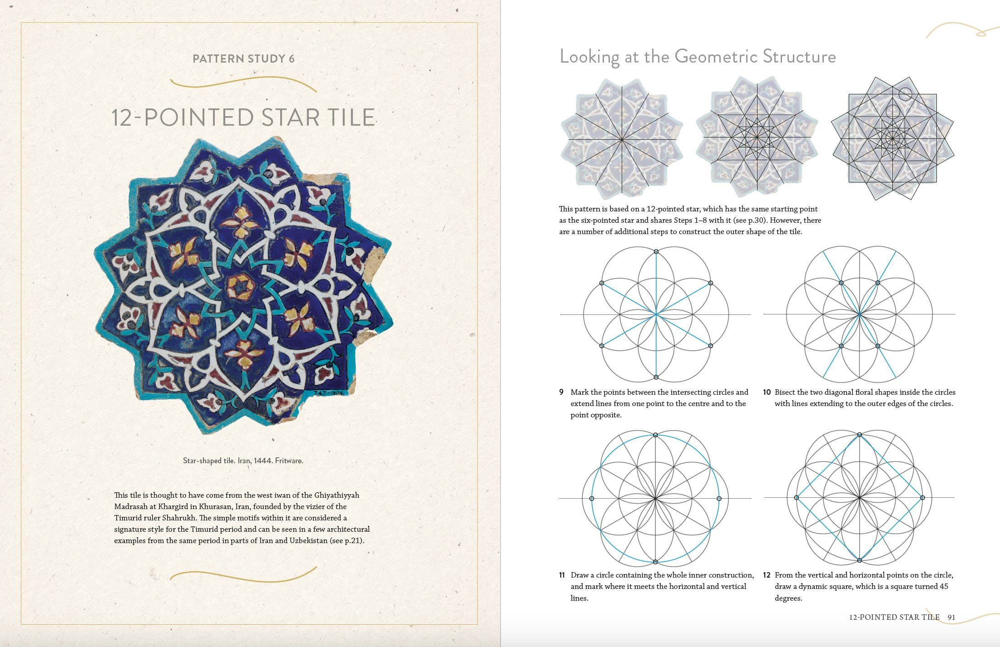

# مستندات پروژه: ترسیم ستاره ۱۲پر با VHDL

## ۱. معرفی پروژه

این پروژه مداری با زبان VHDL توصیف می‌کند که برای هر پیکسل تصویر تشخیص می‌دهد **داخل یک ستاره ۱۲پر است یا بیرون آن**.

- **ورودی مدار:** مختصات یک پیکسل (`pixel_x`, `pixel_y`) و مختصات مرکز ستاره (`center_x`, `center_y`).
- **خروجی مدار:** سیگنال `pattern_on` (مقدار `1` یعنی پیکسل داخل ستاره است) و رنگ ۱۲بیتی `rgb_out` (طلایی برای داخل ستاره، سرمه‌ای تیره برای پس‌زمینه).
- **نتیجه نهایی:** یک Testbench (محیط آزمایش نرم‌افزاری) همه پیکسل‌های یک ناحیه ۲۰۱×۲۰۱ را یکی‌یکی به مدار می‌دهد و پاسخ را در فایل تصویری `star12.pgm` ذخیره می‌کند.

> **نکته مهم:** این طراحی برای **شبیه‌سازی** نوشته شده است، نه برای پیاده‌سازی مستقیم روی FPGA. دلیل آن در بخش «محدودیت‌ها» توضیح داده شده است.

## ۲. مشخصات پروژه

| مورد | مقدار |
|---|---|
| نام Workspace | `twelve_pointed_star` |
| نام Entity طراحی | `starShape` |
| نام Architecture | `Behavioral` |
| نام Testbench | `starShape_TB` (نام entity داخل کد: `starShape_tb`؛ VHDL به بزرگی و کوچکی حروف حساس نیست) |
| دوره کلاک | `10 ns` (فرکانس ۱۰۰ مگاهرتز) |
| مرکز ستاره | `(320, 240)`، یعنی وسط صفحه ۶۴۰×۴۸۰ |
| ناحیه تصویر‌برداری | `x` از ۲۲۰ تا ۴۲۰ و `y` از ۱۴۰ تا ۳۴۰، یعنی ۲۰۱×۲۰۱ پیکسل |
| فایل خروجی | `star12.pgm` |
| زمان شبیه‌سازی | `500 us` |

## ۳. مسیر پروژه (از ایده تا نتیجه)

1. **تعریف مسئله:** مدار باید بگوید هر پیکسل داخل ستاره است یا نه.
2. **استخراج فرمول هندسی:** ستاره با فاصله و زاویه پیکسل نسبت به مرکز توصیف می‌شود (بخش ۴).
3. **نوشتن مدار `starShape`:** فرمول در یک process کلاک‌دار پیاده‌سازی می‌شود (بخش ۵).
4. **نوشتن Testbench:** کلاک می‌سازد، پیکسل‌ها را وارد می‌کند و خروجی را در فایل می‌نویسد (بخش ۶).
5. **اجرای شبیه‌سازی به مدت ۵۰۰ میکروثانیه:** فایل `star12.pgm` تولید می‌شود و Waveform بررسی می‌شود (بخش ۷).
6. **بررسی نتیجه:** فایل PGM به PNG تبدیل و شکل ستاره با چشم بررسی می‌شود.

### ۳.۱ نقشه راه برنامه‌ریزی‌شده (۱۴ روز)

پروژه از ابتدا در ۱۴ روز و با ابزار Active-HDL برنامه‌ریزی شده بود:

| روز | مرحله | خروجی |
|---|---|---|
| ۱ و ۲ | انتخاب نقش هندسی | ستاره ۱۲پر (شمسه ۱۲) |
| ۳ و ۴ | تحلیل هندسی و ریاضی | مختصات و الگوریتم |
| ۵ | طراحی معماری مدار | تعیین ورودی‌ها و خروجی‌ها |
| ۶ تا ۸ | پیاده‌سازی با VHDL | کدنویسی ماژول‌های اصلی |
| ۹ و ۱۰ | پیاده‌سازی در Active-HDL | کامپایل و رفع خطا |
| ۱۱ و ۱۲ | شبیه‌سازی و تست | بررسی صحت تولید مختصات |
| ۱۳ | نمایش گرافیکی نقش | Python و Matplotlib |
| ۱۴ | مستندسازی | آماده‌سازی ارائه |

### ۳.۲ مرجع هندسی: رأس‌های ستاره

نقش اصلی از کاشی‌کاری ایرانی گرفته شده است. تصاویر مرجع پروژه یک کاشی ستاره ۱۲پر تیموری (ایران، ۱۴۴۴ میلادی) با مراحل ساخت هندسی آن از دایره‌های متقاطع، و بازسازی یک نقش الحمراء با همان روش گام‌به‌گام هستند.




در تحلیل اولیه، ستاره با ۲۴ رأس توصیف شد: ۱۲ رأس بیرونی روی شعاع `R_out` با گام ۳۰ درجه، و ۱۲ رأس درونی روی شعاع `R_in` با ۱۵ درجه انحراف:

```latex
X_out(k) = X_c + R_out · cos(k · 30°),   Y_out(k) = Y_c + R_out · sin(k · 30°)
X_in(k)  = X_c + R_in  · cos(k · 30° + 15°),   Y_in(k) = Y_c + R_in · sin(k · 30° + 15°)
k = 0, 1, ..., 11
```

این همان ساختار «نوک و فرورفتگی» بخش ۴ است: نوک‌ها روی مضرب‌های ۳۰ درجه و فرورفتگی‌ها روی ۱۵ درجه بعد از آن‌ها قرار دارند.

### ۳.۳ تفاوت طرح اولیه با پیاده‌سازی نهایی

کد نهایی (`starShape`) از طرح اولیه ساده‌تر و دقیق‌تر شده است. خواننده نباید این دو را یکی بگیرد:

| جنبه | طرح اولیه (`Star12_Generator`) | پیاده‌سازی نهایی (`starShape`) |
|---|---|---|
| روش تشخیص داخل ستاره | مقایسه `r²` با `R_in²` و `R_out²` (فقط یک حلقه بین دو دایره) | شعاع مرز وابسته به زاویه، با فرمول قطبی |
| ریاضیات | عدد صحیح و ثابت‌های LUT، بدون جذر | `real` با `sqrt` و `arctan` و `floor` |
| سنتزپذیری | قابل سنتز | فقط شبیه‌سازی |
| جهت محور y | `dy = pixel_y − Y_c` | `dy = center_y − pixel_y` (محور رو به بالا) |
| نمایش نتیجه | Python و Matplotlib | Testbench، فایل `star12.pgm` و تبدیل به PNG |

دلیل تغییر: حلقه‌ی بین دو دایره ستاره نمی‌سازد و ناحیه‌ای گرد است که مرکز را هم حذف می‌کند. برای ساختن پرها، شعاع مرز باید با زاویه عوض شود و این کار در نسخه نهایی انجام شده است. بهای آن از دست رفتن سنتزپذیری است (بخش ۸).

## ۴. ایده ریاضی: مرز ستاره در مختصات قطبی

به‌جای رسم ضلع‌ها با معادله خط، هر پیکسل با دو عدد توصیف می‌شود:

- **شعاع (r):** فاصله پیکسل تا مرکز.
- **زاویه (θ):** جهت پیکسل نسبت به مرکز.

برای هر زاویه، شعاعی به نام **شعاع مرز** تعریف می‌شود. اگر `r` از شعاع مرز بیشتر نباشد، پیکسل داخل ستاره است.

**چرا ۱۲پر؟** دایره ۳۶۰ درجه دارد و ۱۲ پر یعنی هر پر یک سکتور ۳۰ درجه‌ای است (`360 ÷ 12 = 30`، برابر `π/6` رادیان). شکل ستاره در هر سکتور تکرار می‌شود.

**شکل مرز در هر سکتور ۳۰ درجه‌ای:**

- روی زاویه‌های مضرب ۳۰ درجه (۰، ۳۰، ۶۰ و...) **نوک پر** قرار دارد و شعاع مرز برابر `OUTER_RADIUS = 100` است.
- وسط دو نوک (زاویه‌های ۱۵، ۴۵ و...) **فرورفتگی** قرار دارد و شعاع مرز برابر `INNER_RADIUS = 55` است.
- بین این دو نقطه، شعاع مرز **به‌صورت خطی** تغییر می‌کند، پس لبه‌های ستاره مستقیم هستند.

| زاویه درون سکتور | موقعیت | شعاع مرز |
|---|---|---|
| ۰° | نوک پر | ۱۰۰ |
| ۷٫۵° | نیمه راه | ۷۷٫۵ |
| ۱۵° | فرورفتگی | ۵۵ |
| ۲۲٫۵° | نیمه راه | ۷۷٫۵ |
| ۳۰° | نوک پر بعدی | ۱۰۰ |

[محل درج تصویر ۱: خروجی نهایی ستاره ۱۲پر، `star12.png`]

## ۵. توضیح بخش‌به‌بخش طراحی (`starShape`)

### ۵.۱ کتابخانه‌ها

```vhdl
library IEEE;
use IEEE.STD_LOGIC_1164.ALL;
use IEEE.NUMERIC_STD.ALL;
use IEEE.MATH_REAL.ALL;
```

| کتابخانه | کاربرد در این پروژه |
|---|---|
| `STD_LOGIC_1164` | تعریف نوع‌های `std_logic` و `std_logic_vector` (منطق ۹حالته) برای پورت‌ها |
| `NUMERIC_STD` | در این کد استفاده نشده است و حذف آن مشکلی ایجاد نمی‌کند |
| `MATH_REAL` | توابع ریاضی `sqrt` (جذر)، `arctan` (آرک‌تانژانت) و `floor` (جزء صحیح)، و ثابت‌ها و محاسبات با نوع `real` |

### ۵.۲ Entity: واسط مدار با دنیای بیرون

```vhdl
entity starShape is
port (
    clk        : in  std_logic;
    reset      : in  std_logic;
    enable     : in  std_logic;
    pixel_x    : in  integer range 0 to 1023;
    pixel_y    : in  integer range 0 to 1023;
    center_x   : in  integer range 0 to 1023;
    center_y   : in  integer range 0 to 1023;
    pattern_on : out std_logic;
    rgb_out    : out std_logic_vector(11 downto 0)
);
end starShape;
```

Entity فقط پورت‌ها را معرفی می‌کند و رفتار مدار را در Architecture می‌نویسیم.

| پورت | جهت | توضیح |
|---|---|---|
| `clk` | ورودی | کلاک؛ مدار فقط در لبه بالارونده آن کار می‌کند |
| `reset` | ورودی | با مقدار `1`، خروجی‌ها را فوراً پاک می‌کند |
| `enable` | ورودی | با مقدار `1` محاسبه فعال است، با `0` مدار چیزی نمی‌کشد |
| `pixel_x`, `pixel_y` | ورودی | مختصات پیکسل مورد بررسی |
| `center_x`, `center_y` | ورودی | مختصات مرکز ستاره |
| `pattern_on` | خروجی | `1` یعنی پیکسل داخل ستاره است |
| `rgb_out` | خروجی | رنگ پیکسل، ۱۲ بیت |

**چرا `integer range 0 to 1023`؟** محدود کردن بازه، عدد را به ۱۰ بیت می‌رساند (`2^10 = 1024`) و برای صفحه‌های تا ۱۰۲۴ پیکسل کافی است. بدون `range` نوع `integer` ۳۲بیتی می‌شود.

**چرا `rgb_out` دوازده بیت است؟** رنگ به فرمت RGB 4-4-4 است: ۴ بیت قرمز، ۴ بیت سبز و ۴ بیت آبی.

### ۵.۳ ثابت‌ها (Constants)

```vhdl
constant PI               : real := 3.14159265358979323846;
constant OUTER_RADIUS     : real := 100.0;
constant INNER_RADIUS     : real := 55.0;
constant GOLDEN_COLOR     : std_logic_vector(11 downto 0) := "111110100000";
constant BACKGROUND_COLOR : std_logic_vector(11 downto 0) := "000100010011";
```

| ثابت | مقدار | معنی |
|---|---|---|
| `PI` | ۳٫۱۴۱۵۹... | برای تبدیل زاویه به رادیان و تقسیم دایره |
| `OUTER_RADIUS` | ۱۰۰ | شعاع نوک پرها (به پیکسل) |
| `INNER_RADIUS` | ۵۵ | شعاع فرورفتگی بین پرها (به پیکسل) |
| `GOLDEN_COLOR` | `1111 1010 0000` | قرمز=۱۵، سبز=۱۰، آبی=۰ (طلایی) |
| `BACKGROUND_COLOR` | `0001 0001 0011` | قرمز=۱، سبز=۱، آبی=۳ (سرمه‌ای بسیار تیره) |

**دلیل استفاده از ثابت:** اندازه ستاره یا رنگ‌ها را فقط با تغییر یک خط عوض می‌کنیم و عدد جادویی لابه‌لای کد باقی نمی‌ماند.

### ۵.۴ ساختار Process و Reset

```vhdl
process(clk, reset)
variable dx, dy, radius, angle : real;
variable normalized_angle, sector_angle, boundary_radius : real;
begin
    if reset = '1' then
        pattern_on <= '0';
        rgb_out    <= (others => '0');
    elsif rising_edge(clk) then
        if enable = '1' then
            -- محاسبات (بخش ۵.۵)
        else
            pattern_on <= '0';
            rgb_out    <= BACKGROUND_COLOR;
        end if;
    end if;
end process;
```

- **لیست حساسیت `(clk, reset)`:** process با تغییر `clk` یا `reset` اجرا می‌شود.
- **ریست آسنکرون:** چون `reset` بیرون از شرط لبه کلاک بررسی می‌شود، به‌محض فعال شدن و بدون انتظار برای کلاک اثر می‌کند. خروجی‌ها صفر می‌شوند (رنگ سیاه).
- **`rising_edge(clk)`:** محاسبه فقط در لبه بالارونده (`0 → 1`) کلاک انجام می‌شود. در نتیجه خروجی ثبت‌شده است و **یک کلاک بعد از ورودی** آماده می‌شود. Testbench این تأخیر را در نظر می‌گیرد.
- **`enable = '0'`:** خروجی `pattern_on = 0` و رنگ پس‌زمینه است.
- **متغیرها (`variable`):** مقدارشان بلافاصله عوض می‌شود، پس می‌توان محاسبات را گام‌به‌گام و پشت‌سرهم نوشت. در مقابل، سیگنال‌ها (`pattern_on` و `rgb_out`) با یک تأخیر دلتا، در پایان اجرای process، مقدار می‌گیرند.

### ۵.۵ محاسبات، گام به گام

**گام ۱: فاصله افقی و عمودی از مرکز**

```vhdl
dx := real(pixel_x - center_x);
dy := real(center_y - pixel_y);
```

مرکز ستاره را مبدأ مختصات قرار می‌دهیم. دقت کنید `dy` برعکس نوشته شده است: در تصویر، `y` به سمت **پایین** زیاد می‌شود، اما در ریاضی `y` به سمت **بالا** زیاد می‌شود. این برعکس‌سازی باعث می‌شود ستاره درست و نه وارونه رسم شود. تابع `real()` عدد صحیح را به اعشاری تبدیل می‌کند، چون توابع ریاضی روی `real` کار می‌کنند.

**گام ۲: فاصله تا مرکز (شعاع)**

```vhdl
radius := sqrt(dx * dx + dy * dy);
```

فرمول فیثاغورس: `r = √(dx² + dy²)`.

**گام ۳: زاویه پیکسل**

```vhdl
if (dx = 0.0) and (dy = 0.0) then
    angle := 0.0;
else
    angle := arctan(dy, dx);
end if;
```

`arctan(dy, dx)` زاویه را بین `-π` تا `+π` برمی‌گرداند. در خود مرکز (`dx = dy = 0`) زاویه تعریف نشده است و ممکن است در شبیه‌ساز خطا بدهد، به همین دلیل برای این حالت مقدار ۰ گذاشته شده است. مرکز در هر حال داخل ستاره است، پس مقدار زاویه آنجا اثری ندارد.

**گام ۴: تبدیل زاویه به بازه ۰ تا ۲π**

```vhdl
if angle < 0.0 then
    angle := angle + 2.0 * PI;
end if;
```

زاویه منفی با افزودن یک دور کامل به معادل مثبتش تبدیل می‌شود تا محاسبات بعدی (تقسیم بر اندازه سکتور) ساده بماند.

**گام ۵: پیدا کردن موقعیت درون سکتور ۳۰ درجه‌ای**

```vhdl
sector_angle     := PI / 6.0;
normalized_angle := angle / sector_angle;
normalized_angle := normalized_angle - floor(normalized_angle);
```

- `PI / 6.0` یعنی ۳۰ درجه، اندازه هر سکتور.
- تقسیم زاویه بر اندازه سکتور، عددی مثل `2.3` می‌دهد (یعنی سکتور شماره ۲ و ۳۰٪ از آن).
- کسر `floor` را کم می‌کنیم تا فقط **جزء اعشاری** بماند. نتیجه عددی بین ۰ و ۱ است که می‌گوید پیکسل در کدام نقطه از سکتور قرار دارد، مستقل از اینکه کدام سکتور باشد. همین کار باعث می‌شود شکل برای هر ۱۲ پر تکرار شود.

**گام ۶: قرینه‌سازی نیمه دوم سکتور**

```vhdl
if normalized_angle > 0.5 then
    normalized_angle := 1.0 - normalized_angle;
end if;
```

بعد از این گام، مقدار `normalized_angle` همیشه بین ۰ و ۰٫۵ است و نشان می‌دهد پیکسل **چقدر از نوک پر دور است**: ۰ یعنی دقیقاً روی نوک و ۰٫۵ یعنی دقیقاً روی فرورفتگی. این کار باعث می‌شود هر پر از دو طرف قرینه باشد.

**گام ۷: محاسبه شعاع مرز**

```vhdl
boundary_radius := INNER_RADIUS
    + (OUTER_RADIUS - INNER_RADIUS) * (1.0 - normalized_angle * 2.0);
```

عبارت `(1 - normalized_angle × 2)` مقدار را به بازه ۰ تا ۱ می‌برد: روی نوک برابر ۱ و روی فرورفتگی برابر ۰. پس:

- روی نوک: `55 + 45 × 1 = 100`
- روی فرورفتگی: `55 + 45 × 0 = 55`

این درون‌یابی خطی است و لبه‌های مستقیم ستاره را می‌سازد.

**گام ۸: تصمیم نهایی**

```vhdl
if radius <= boundary_radius then
    pattern_on <= '1';
    rgb_out    <= GOLDEN_COLOR;
else
    pattern_on <= '0';
    rgb_out    <= BACKGROUND_COLOR;
end if;
```

اگر فاصله پیکسل تا مرکز از شعاع مرز همان زاویه بیشتر نباشد، پیکسل داخل ستاره است و طلایی می‌شود؛ در غیر این صورت رنگ پس‌زمینه می‌گیرد.

### ۵.۶ خلاصه رفتار خروجی‌ها

| شرایط | `pattern_on` | `rgb_out` |
|---|---|---|
| `reset = 1` | `0` | سیاه (`000000000000`) |
| `enable = 0` | `0` | پس‌زمینه |
| `enable = 1` و پیکسل داخل ستاره | `1` | طلایی |
| `enable = 1` و پیکسل بیرون ستاره | `0` | پس‌زمینه |

## ۶. توضیح بخش‌به‌بخش Testbench (`starShape_TB`)

Testbench مداری برای ساخت نیست؛ فقط یک محیط آزمایش نرم‌افزاری است که ورودی‌ها را به مدار می‌دهد و خروجی را بررسی می‌کند. به همین دلیل ورودی و خروجی (پورت) ندارد.

### ۶.۱ کتابخانه‌ها و Entity خالی

```vhdl
library IEEE;
use IEEE.STD_LOGIC_1164.ALL;
use IEEE.NUMERIC_STD.ALL;
use STD.TEXTIO.ALL;

entity starShape_tb is
end starShape_tb;
```

`STD.TEXTIO` امکان خواندن و نوشتن فایل متنی را فراهم می‌کند و برای ساختن `star12.pgm` لازم است.

### ۶.۲ معرفی مدار تحت آزمون (Component)

```vhdl
component starShape
port ( ...پورت‌ها دقیقاً مانند Entity... );
end component;
```

تعریف Component به Testbench می‌گوید مدار `starShape` چه پورت‌هایی دارد. پورت‌ها باید دقیقاً با Entity یکی باشند.

### ۶.۳ سیگنال‌ها و مقدار اولیه

```vhdl
signal clk      : std_logic := '0';
signal reset    : std_logic := '1';
signal enable   : std_logic := '0';
signal pixel_x  : integer range 0 to 1023 := 0;
signal pixel_y  : integer range 0 to 1023 := 0;
signal center_x : integer range 0 to 1023 := 320;
signal center_y : integer range 0 to 1023 := 240;
signal pattern_on : std_logic;
signal rgb_out    : std_logic_vector(11 downto 0);

constant CLK_PERIOD : time := 10 ns;
```

برای هر پورت مدار یک سیگنال می‌سازیم تا به آن وصل شود. مدار با `reset = 1` و `enable = 0` شروع می‌کند و مرکز ستاره روی `(320, 240)` است. `CLK_PERIOD` دوره کلاک است. نوع `time` فقط برای شبیه‌سازی است.

### ۶.۴ فایل خروجی

```vhdl
file image_file : text open write_mode is "star12.pgm";
```

فایل `star12.pgm` برای نوشتن باز می‌شود و در پوشه کاری شبیه‌ساز ساخته می‌شود. **PGM** یک فرمت ساده تصویر خاکستری است که به‌صورت متن نوشته می‌شود، به همین دلیل VHDL می‌تواند مستقیم آن را تولید کند.

### ۶.۵ اتصال مدار (Port Map)

```vhdl
uut: starShape
port map (
    clk => clk, reset => reset, enable => enable,
    pixel_x => pixel_x, pixel_y => pixel_y,
    center_x => center_x, center_y => center_y,
    pattern_on => pattern_on, rgb_out => rgb_out
);
```

`uut` مخفف Unit Under Test است. اتصال به‌صورت نام‌به‌نام انجام شده تا ترتیب پورت‌ها اهمیتی نداشته باشد و خطا کمتر شود.

### ۶.۶ تولید کلاک

```vhdl
clk_process : process
begin
    clk <= '0';
    wait for CLK_PERIOD / 2;
    clk <= '1';
    wait for CLK_PERIOD / 2;
end process;
```

این process تا پایان شبیه‌سازی تکرار می‌شود: ۵ ns صفر، ۵ ns یک. نتیجه کلاک با دوره ۱۰ ns است.

### ۶.۷ تولید ورودی و ثبت نتیجه (`stim_proc`)

**الف) ریست اولیه و فعال‌سازی**

```vhdl
reset <= '1';
enable <= '0';
wait for 20 ns;

reset <= '0';
enable <= '1';
wait until falling_edge(clk);
```

مدار ۲۰ ns در حالت ریست می‌ماند تا وضعیت اولیه‌اش مشخص شود. سپس ریست برداشته و `enable` فعال می‌شود. انتظار برای لبه پایین‌رونده کلاک، شروع ورودی‌ها را از لبه بالارونده دور نگه می‌دارد تا ورودی‌ها هنگام نمونه‌برداری مدار پایدار باشند.

**ب) نوشتن سرآیند فایل PGM**

```vhdl
write(row, string'("P2"));      writeline(image_file, row);
write(row, string'("201 201")); writeline(image_file, row);
write(row, string'("255"));     writeline(image_file, row);
```

| خط | معنی |
|---|---|
| `P2` | فرمت PGM متنی (خاکستری) |
| `201 201` | عرض و ارتفاع تصویر |
| `255` | بیشینه مقدار روشنایی (۰ = سیاه، ۲۵۵ = سفید) |

**ج) پیمایش همه پیکسل‌ها**

```vhdl
for y in 140 to 340 loop
    for x in 220 to 420 loop
        pixel_x <= x;
        pixel_y <= y;

        wait until rising_edge(clk);
        wait for 1 ns;

        if pattern_on = '1' then pixel_value := 255;
        else                     pixel_value := 0;
        end if;

        write(row, pixel_value);
        write(row, string'(" "));
    end loop;
    writeline(image_file, row);
end loop;
```

- **چرا این بازه؟** مرکز `(320, 240)` و شعاع نوک پرها ۱۰۰ است، پس ستاره دقیقاً در `x ∈ [220, 420]` و `y ∈ [140, 340]` جا می‌شود. این یعنی `201 × 201` پیکسل.
- **`wait until rising_edge(clk)`:** مدار پیکسل را در همین لبه کلاک نمونه می‌گیرد و پاسخ را ثبت می‌کند.
- **`wait for 1 ns`:** خروجی مدار کمی بعد از لبه کلاک به‌روز می‌شود. این ۱ ns صبر می‌کند تا مقدار جدید پایدار شود و Testbench مقدار قدیمی را نخواند.
- **نوشتن نتیجه:** داخل ستاره `255` (سفید) و بیرون آن `0` (سیاه). بعد از هر ردیف پیکسل، یک خط جدید در فایل ثبت می‌شود.
- هر پیکسل **یک سیکل کلاک** طول می‌کشد.

**د) پایان کار**

```vhdl
file_close(image_file);

assert false
    report "Image generation completed: star12.pgm"
    severity note;

wait;
```

- `file_close` فایل را می‌بندد تا محتوای آن کامل ذخیره شود.
- `assert false ... severity note` یک ترفند رایج برای چاپ پیام در کنسول شبیه‌ساز است (شرط همیشه نادرست است، پس پیام همیشه چاپ می‌شود، و چون سطح آن `note` است شبیه‌سازی متوقف نمی‌شود).
- `wait;` بدون شرط، process را برای همیشه متوقف می‌کند تا ورودی‌ها دوباره تکرار نشوند.

## ۷. اجرای شبیه‌سازی و نتایج

**چرا ۵۰۰ میکروثانیه؟** پردازش هر پیکسل یک سیکل ۱۰ ns طول می‌کشد:

`201 × 201 = 40,401 پیکسل` ← `40,401 × 10 ns ≈ 404 µs`

بنابراین کل کار حدود ۴۰۴ میکروثانیه (به‌علاوه چند ns شروع) زمان می‌خواهد و اجرای ۵۰۰ میکروثانیه‌ای برای تکمیل فایل کافی است. اگر شبیه‌سازی کوتاه‌تر اجرا شود، تصویر ناقص تولید می‌شود.

**بررسی Waveform:** سیگنال‌های `clk`، `reset`، `enable`، `pixel_x`، `pixel_y`، `center_x`، `center_y`، `pattern_on` و `rgb_out` را می‌بینیم. انتظار می‌رود:

- در ۲۰ ns اول `reset = 1` باشد، سپس `reset = 0` و `enable = 1` شود.
- `pixel_x` در هر ردیف از ۲۲۰ تا ۴۲۰ بالا برود و `pixel_y` بعد از هر ردیف یک واحد زیاد شود.
- `pattern_on` فقط هنگام عبور از داخل ستاره `1` شود و `rgb_out` همزمان بین طلایی و پس‌زمینه عوض شود.

[محل درج تصویر ۲: شبیه‌سازی ۵۰۰ us و Waveform]

**نتیجه نهایی:** فایل `star12.pgm` تصویری سیاه‌وسفید است که ستاره ۱۲پر سفید روی زمینه سیاه دارد. برای نمایش در برنامه‌های معمولی می‌توان آن را به PNG تبدیل کرد (`star12.png`). دقت کنید تصویر فقط از `pattern_on` ساخته می‌شود و رنگ طلایی (`rgb_out`) در آن دیده نمی‌شود.

[محل درج تصویر ۳: `star12.png`]

## ۸. محدودیت‌ها و نکات

- **این طراحی قابل سنتز نیست.** `sqrt`، `arctan`، `floor` و نوع `real` از `MATH_REAL` فقط در شبیه‌سازی کار می‌کنند و ابزار سنتز آن‌ها را به سخت‌افزار تبدیل نمی‌کند. همچنین کار با فایل و `wait for` در Testbench فقط مخصوص شبیه‌سازی است. این پروژه یک **مدل رفتاری** برای بررسی ایده هندسی است.
- **برای پیاده‌سازی روی FPGA** باید محاسبات با عدد صحیح یا ممیز ثابت بازنویسی شوند، مثلاً با الگوریتم CORDIC برای زاویه، یا با مقایسه مربع فاصله و جدول مقادیر شعاع مرز، تا منابع سخت‌افزاری مثل LUT و فلیپ‌فلاپ مصرف شوند.
- **رنگ ریست و غیرفعال متفاوت است:** ریست خروجی را سیاه می‌کند و `enable = 0` رنگ پس‌زمینه می‌دهد.
- **تغییر اندازه یا رنگ:** با تغییر `OUTER_RADIUS`، `INNER_RADIUS` و رنگ‌ها در بخش ثابت‌ها انجام می‌شود. در این صورت بازه حلقه‌های Testbench و ابعاد PGM هم باید با شعاع جدید هماهنگ شوند.
- **تعداد پرها:** مقدار `PI / 6.0` تعداد پرها را تعیین می‌کند. با `PI / N` ستاره‌ای با `2N` پر ساخته می‌شود.

## ۹. واژه‌نامه

| واژه | معنی |
|---|---|
| Entity | تعریف ورودی و خروجی‌های مدار |
| Architecture | توصیف عملکرد داخلی مدار |
| Testbench | محیط آزمایش نرم‌افزاری برای اعمال ورودی و بررسی خروجی |
| Process | بلوکی که دستورهایش پشت‌سرهم اجرا می‌شوند |
| Variable | مقدار موقتی داخل process که فوراً به‌روز می‌شود |
| Signal | معادل سیم در مدار، با به‌روزرسانی تأخیردار |
| Waveform | نمودار زمانی سیگنال‌ها در شبیه‌سازی |
| PGM | فرمت ساده تصویر خاکستری |
| RGB 4-4-4 | رنگ ۱۲بیتی با ۴ بیت برای هر کانال قرمز، سبز و آبی |
| سنتز | تبدیل کد VHDL به ساختار سخت‌افزاری واقعی |
